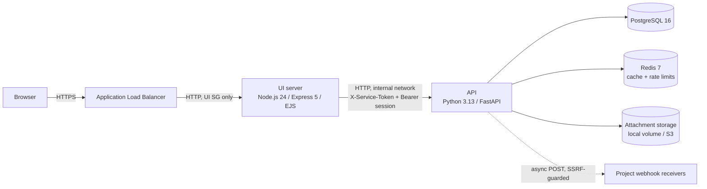
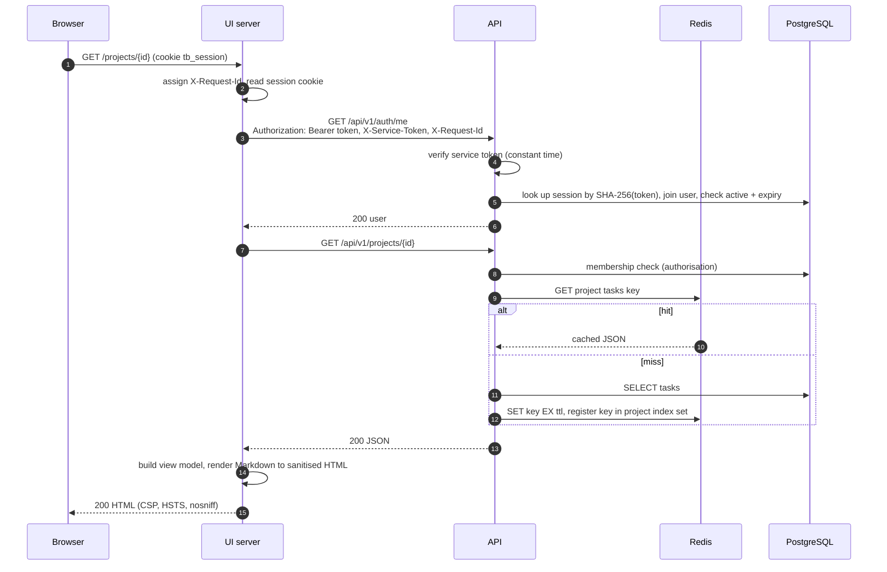
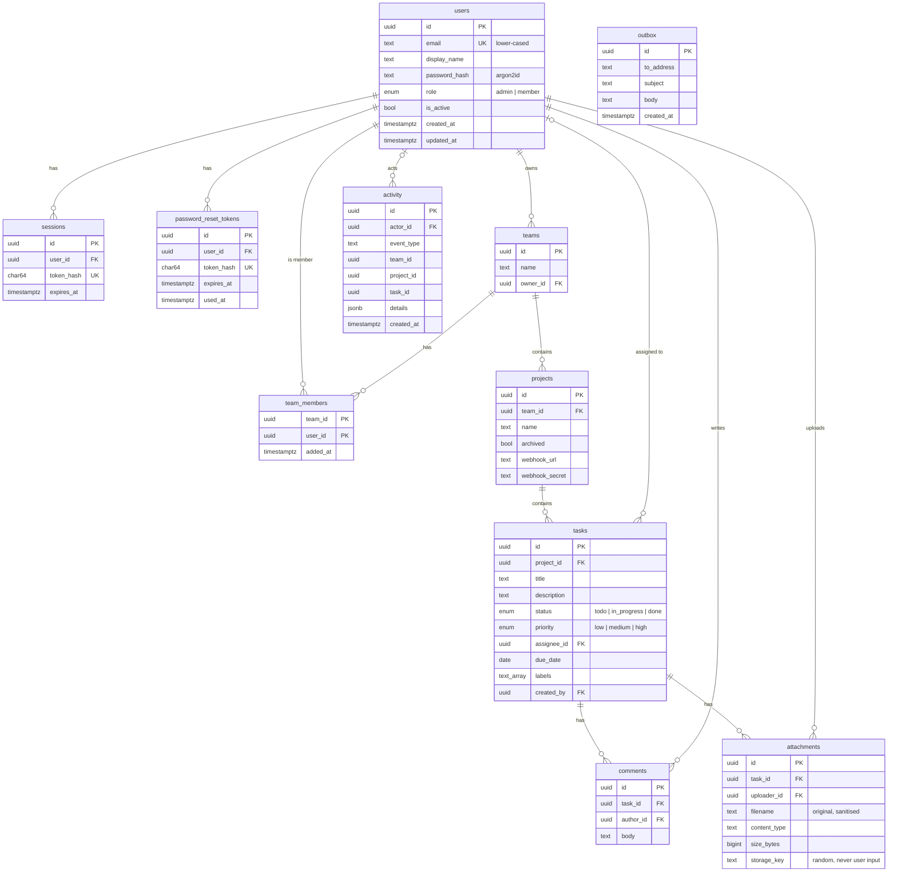
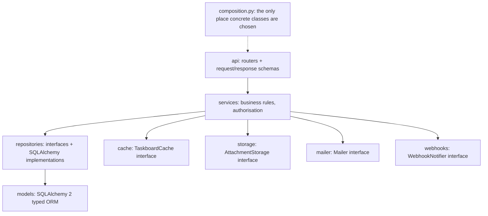
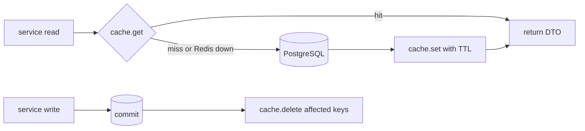

# Taskboard architecture

Taskboard is a small internal task tracker. Users register, form teams, create projects inside a team
and manage tasks with comments and attachments. Admins manage users.

## Components



| Component | Responsibility | Talks to |
| --- | --- | --- |
| UI server (`ui/`) | Renders HTML pages, owns the browser session cookie, CSRF protection, security headers, Markdown rendering and sanitisation | API only, through one typed client class |
| API (`api/`) | All business rules, authorisation, persistence, caching, email outbox, webhooks, attachment storage | PostgreSQL, Redis, storage, webhook URLs |
| PostgreSQL | System of record | - |
| Redis | Cache-aside store and rate-limit counters. Optional: the API degrades to uncached reads and in-process rate limits | - |
| Storage | Attachment bytes. `LocalFileStorage` in dev, `S3Storage` in AWS, behind the `AttachmentStorage` interface | - |

The API is never reachable from outside: in Compose it has no published port, and in AWS it lives in
private subnets behind a security group that only admits the UI instances.

## Request flow



The UI server generates a request id per incoming request (or accepts a well-formed incoming
`X-Request-Id`), sends it to the API in `X-Request-Id`, and both services put it in every JSON log line.

## Authentication design

- **Credentials** are only ever checked by the API. Passwords are hashed with Argon2id (`argon2-cffi`).
  A login for an unknown email still runs a hash verification against a dummy hash so response time
  does not reveal whether the account exists. Unknown email, wrong password and deactivated account
  all return the same `401 invalid credentials`.
- **Sessions** are server-side rows in the `sessions` table. On login the API creates a 256-bit random
  token, stores only its SHA-256 hash with an absolute expiry (`SESSION_TTL_HOURS`, default 12) and
  returns the raw token once. Logout deletes the row; a password change deletes every other session of
  the user; a password reset or deactivation deletes all of them. Session lookup is never cached, so
  revocation is immediate.
- **Browser cookie.** The UI server stores the raw token in the `tb_session` cookie: `HttpOnly`,
  `SameSite=Lax`, `Secure` (configurable only so plain-HTTP local dev works), `Path=/`, with the same
  lifetime as the session. The browser never sees the API.
- **Identity to the API.** The UI forwards the token as `Authorization: Bearer <token>`. The API resolves
  it to a user on every request, so the API never trusts a user id supplied by the UI.
- **Service authentication.** Every `/api/v1` request must also carry `X-Service-Token`, a shared secret
  (`SERVICE_TOKEN`, at least 32 characters) compared in constant time. This is defence in depth on top of
  network isolation: something that reaches the API port from inside the network (for example through
  a server-side request forgery) still cannot call it. The UI also forwards the browser's address in
  `X-Client-Ip`, which the API only uses for rate limiting because the caller is authenticated.
- **CSRF.** All state-changing UI routes are `POST` forms. The UI issues a random `tb_csrf` cookie
  (`HttpOnly`, `SameSite=Lax`) and embeds `HMAC-SHA256(UI_SECRET, cookie)` as a hidden `_csrf` field. A
  POST is accepted only if the field matches (constant-time compare) and, when the browser sends an
  `Origin` header, it equals `PUBLIC_URL`. This covers anonymous forms (login, register, reset) too.
- **Rate limits** (API, fixed window, Redis with in-process fallback): login per email and per client
  IP, forgot-password per email and per IP, register and reset per IP. Exceeding a limit returns 429.
- **Password reset.** `forgot` always returns 202. If the account exists and is active, the API stores
  the SHA-256 of a random token with a 30-minute expiry, invalidates older unused tokens, and "sends" an
  email containing `PUBLIC_UI_URL/reset-password?token=...` (built from configuration, never from the
  request's Host header). `reset` accepts a token once, sets the password and revokes all sessions.
- **Roles.** `member` (default) and `admin`. Admins can do everything, including reading every team.
  An admin cannot demote or deactivate their own account, which prevents locking the system out of
  administrators. The first admin comes from `taskboard-api create-admin`, which reads
  `ADMIN_EMAIL`, `ADMIN_PASSWORD` and `ADMIN_DISPLAY_NAME`.

### Authorisation rules

| Resource | Read | Write |
| --- | --- | --- |
| Team | members, admins | owner, admins (add or remove members; the owner cannot be removed) |
| Project | team members, admins | create, rename, webhook, archive: owner, admins |
| Task | team members, admins | create, edit, delete: team members, admins; project must be active |
| Comment | team members, admins | create: members, admins; edit and delete: the author only; project must be active |
| Attachment | team members, admins | upload: members, admins; project must be active |
| Users | own profile | role and active flag: admins only (never on themselves) |
| Activity | project feed: team members; global feed: admins | written by the API only |

Requests for a team, project, task, comment or attachment that the caller cannot read return **404**
rather than 403, so ids of other teams' resources cannot be probed. Ids are random UUIDs.

## Data model



- Deleting a task cascades to its comments and attachment rows; the attachment bytes are deleted from
  storage after the transaction commits. Activity rows keep their history (`task_id` is not a foreign
  key) so the feed survives deletes.
- Removing a member from a team unassigns them from that team's tasks.
- Every schema change is an Alembic migration (`api/migrations/`). The app never calls `create_all`
  outside tests. Migrations take a PostgreSQL advisory lock so several API instances can start at once.

## API layering



- Routers only parse input, call one service method and return the result. They depend on services
  through FastAPI `Depends` providers defined in `taskboard_api/composition.py`.
- Services receive a `UnitOfWork` (repositories plus commit/rollback) and the infrastructure
  interfaces. Unit tests construct services with in-memory fakes.
- Domain errors (`NotFoundError`, `PermissionDeniedError`, `ConflictError`, `ValidationFailedError`,
  `AuthenticationError`, `RateLimitedError`, `PayloadTooLargeError`) are mapped to HTTP responses in
  one handler module (`api/errors.py`).

## API contract

Base path `/api/v1`, JSON bodies, OpenAPI at `/api/v1/openapi.json` (internal only). All `/api/v1` routes
need `X-Service-Token`; all except register, login, forgot and reset need a bearer session.
Error bodies are `{"error": {"code": "...", "message": "...", "fields": {...}}}`.

| Method and path | Purpose | Notes |
| --- | --- | --- |
| `POST /auth/register` | create a member account | 201 user; 409 if the email exists |
| `POST /auth/login` | create a session | 200 `{token, expires_at, user}` |
| `POST /auth/logout` | delete the current session | 204 |
| `GET /auth/me` | own profile | cached |
| `POST /auth/password/change` | change password | revokes other sessions |
| `POST /auth/password/forgot` | request reset email | always 202 |
| `POST /auth/password/reset` | set password with token | revokes all sessions |
| `GET, POST /teams` | my teams / create team | list cached per user |
| `GET /teams/{id}` | team with members | |
| `POST /teams/{id}/members` | add member by email | owner, admin |
| `DELETE /teams/{id}/members/{user_id}` | remove member | owner, admin |
| `GET, POST /teams/{id}/projects` | list / create projects | create: owner, admin |
| `GET /projects` | every project I can see | added for the dashboard, see DECISIONS |
| `GET, PATCH /projects/{id}` | read / rename, set webhook | |
| `POST /projects/{id}/archive` | archive | read-only afterwards |
| `GET, POST /projects/{id}/tasks` | list (filters, sort, pages) / create | list cached per filter combination |
| `GET /projects/{id}/export.csv` | CSV export | formula-injection safe |
| `GET /projects/{id}/activity` | project feed | |
| `GET, PATCH, DELETE /tasks/{id}` | task detail / update / delete | detail cached |
| `GET, POST /tasks/{id}/comments` | comments | |
| `PATCH, DELETE /comments/{id}` | edit / delete own comment | |
| `GET, POST /tasks/{id}/attachments` | list / upload (multipart, 10 MB) | |
| `GET /attachments/{id}/download` | stream file | `Content-Disposition: attachment` |
| `GET /search/tasks` | cross-project search | `q`, `status`, `assignee_id`, `label`, `due_before`, `sort`, `order`, `page`, `page_size` |
| `GET /admin/users`, `PATCH /admin/users/{id}` | list users, change role or active flag | admin |
| `GET /admin/activity` | global feed | admin |
| `GET /admin/cache-stats` | cache hit/miss counters | admin |
| `GET /healthz`, `GET /readyz` | liveness, readiness (DB required, Redis reported) | no auth |

Lists return `{"items": [...], "page": n, "page_size": n, "total": n}`; `page_size` is capped at 100.
`sort` must be one of the task fields (`title`, `description`, `status`, `priority`, `assignee_id`,
`due_date`, `labels`, `created_at`, `updated_at`) and `order` one of `asc`, `desc`; anything else is a
422, and the column is chosen from an allow-list, never interpolated.

### Webhooks

When a task's status changes, the service schedules a delivery after the transaction commits. The
`ThreadPoolWebhookNotifier` posts, from a worker thread, this JSON body:

```json
{"event": "task.status_changed", "task_id": "...", "project_id": "...", "old_status": "todo",
 "new_status": "done", "actor_id": "...", "timestamp": "2026-10-18T09:14:03Z"}
```

It signs the body with the project's secret (`X-Taskboard-Signature: sha256=<hex HMAC>`), allows
5 seconds per attempt and retries up to 3 attempts with a short backoff. Webhook URLs must be `https`
(plain `http` only when `WEBHOOK_ALLOW_HTTP=true`), must not contain credentials, and at delivery
time every resolved address must be a public unicast address; the request is pinned to the checked
address (TLS still verifies the original host name), redirects are not followed, and the response body
is discarded. This blocks requests to the instance metadata service, the VPC and loopback.

## Caching



Cache-aside behind the `Cache` interface (`RedisCache`, `InMemoryCache`, `NullCache`), used by
`TaskboardCache`, which owns key naming and invalidation rules.

| Key | Content | Invalidated by |
| --- | --- | --- |
| `tb:user:{id}:profile` | profile DTO | admin role or active change |
| `tb:user:{id}:teams` | user's team list | team created by the user, member added or removed |
| `tb:user:{id}:projects` | user's project list | project created, renamed or archived in any of the user's teams; member added or removed |
| `tb:project:{id}:tasks:{sha256(filters)}` | one page of one filter combination | any task create, update or delete in the project; member removal (unassign) |
| `tb:project:{id}:tasks:index` | set of the page keys above | used to delete them all |
| `tb:task:{id}` | task detail DTO | task update or delete; member removal (unassign) |

- Invalidation happens after the database commit. TTL (`CACHE_TTL_SECONDS`, default 300) is a backstop.
- Authorisation runs before every cache read: cached data is never served to a caller who fails the
  membership check, and per-user keys only hold that user's own data.
- Every get records a hit or miss in thread-safe counters and logs it at debug level with the counters.
  Admins can read the counters at `GET /api/v1/admin/cache-stats`.
- Redis errors are caught and logged; after a failure the cache stops calling Redis for 30 seconds and
  behaves as a miss, so the API keeps working, slower, while Redis is down.

## UI server

- `TaskboardApiClient` (`ui/src/api/`) is the only code that calls the API. It implements the
  `ApiClient` interface; tests use a fake implementation.
- Controllers are classes, one per area (auth, dashboard, teams, projects, tasks, search, profile,
  admin, health). View-model builders turn API DTOs into what the EJS templates need, including
  rendering Markdown with `marked` and sanitising the HTML with `sanitize-html` (allow-listed tags,
  `http`, `https` and `mailto` links only, `rel="noopener noreferrer nofollow"`).
- Middleware classes: request id and logging, security headers (Helmet with a strict CSP and no inline
  scripts), CSRF, session (loads the current user through `/auth/me`), flash messages (signed cookie),
  error handling.
- Uploads go through `multer` in memory with a 10 MB limit, then to the API as multipart. Downloads are
  streamed from the API with `Content-Disposition: attachment` and `X-Content-Type-Options: nosniff`.
