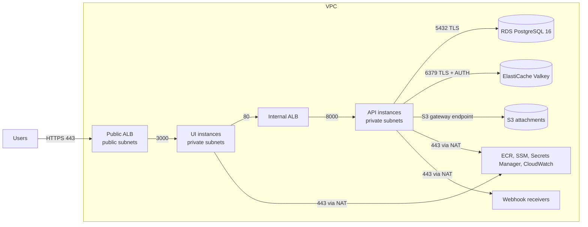
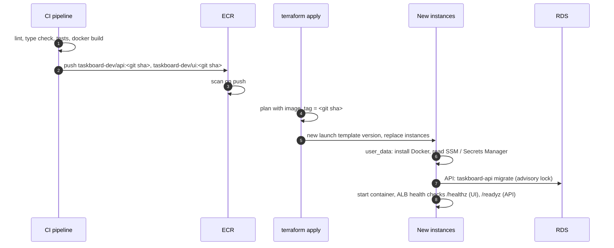

# Deploying Taskboard to AWS

Nothing in this repository has been applied to a real AWS account. The Terraform code passes
`terraform fmt -check -recursive` and `terraform validate`; this document describes how a
deployment is meant to work.

## Target architecture



Every arrow is a security group rule that references the previous group; there is no other path.
Instances have no public addresses and no SSH; operators use SSM Session Manager.

## Terraform layout

```
infra/
├── modules/
│   ├── network    VPC over 2+ AZs, public/private subnets, NAT, route tables, S3 gateway endpoint,
│   │              flow logs, locked-down default security group
│   ├── alb        public ALB (TLS 1.3 policy, HTTP->HTTPS redirect), UI target group, access logs
│   ├── ui         UI launch template, EC2 instances, target group attachments, log group
│   ├── api        API launch template, EC2 instances, internal ALB, log group
│   ├── database   RDS PostgreSQL 16 (encrypted, TLS forced, RDS-managed master password)
│   ├── cache      ElastiCache replication group (Valkey 8, TLS required, AUTH token)
│   ├── storage    S3 attachments bucket (SSE-KMS, versioned, TLS-only) and its access-log bucket
│   ├── registry   ECR repositories taskboard-<env>/api and /ui (immutable tags, scan on push)
│   └── iam        instance roles and profiles for ui and api
└── envs/dev/
    ├── versions.tf          provider constraints, partial S3 backend, provider default tags
    ├── main.tf              module composition
    ├── kms.tf               the environment's customer-managed KMS key
    ├── secrets.tf           generated service token and UI secret (SSM SecureString)
    ├── security_rules.tf    security group rules between modules
    ├── variables.tf / outputs.tf
    ├── backend.hcl.example
    └── terraform.tfvars.example
```

Modules own their resources and their own security group; the environment adds the rules between
groups, which avoids a dependency cycle (the API's role needs the database secret, and the database
needs the API's security group).

Every variable has a type and description, constrained values have `validation` blocks, and the
outputs include the ALB DNS name, ECR repository URLs, instance IDs, log groups and secret names.

## Prerequisites

1. An AWS account and a deployment role for Terraform.
2. A state bucket (versioned, SSE-KMS, public access blocked, access limited to the deployment role).
   Copy `backend.hcl.example` to `backend.hcl`.
3. An ACM certificate for the public host name in the target region.
4. A DNS record you can point at the ALB.
5. Copy `terraform.tfvars.example` to `terraform.tfvars` and set the region, zones, `public_url`,
   `certificate_arn`, `allowed_client_cidrs` (office or VPN ranges) and the `image_tag` to deploy.

## End-to-end deployment



### 1. First apply (infrastructure only)

```bash
cd infra/envs/dev
terraform init -backend-config=backend.hcl
terraform apply -target=module.registry   # repositories must exist before images can be pushed
```

### 2. Build and push images

The images are built from `api/Dockerfile` and `ui/Dockerfile` and tagged with the git commit SHA.
Tags are immutable in ECR, so a tag always names exactly one build; `latest` is rejected by the
Terraform validation.

```bash
REGISTRY=$(terraform output -json ecr_repository_urls | jq -r .api | cut -d/ -f1)
aws ecr get-login-password | docker login --username AWS --password-stdin "$REGISTRY"
SHA=$(git rev-parse HEAD)
docker build -t "$(terraform output -json ecr_repository_urls | jq -r .api):$SHA" ../../../api
docker build -t "$(terraform output -json ecr_repository_urls | jq -r .ui):$SHA" ../../../ui
docker push "$(terraform output -json ecr_repository_urls | jq -r .api):$SHA"
docker push "$(terraform output -json ecr_repository_urls | jq -r .ui):$SHA"
```

### 3. Apply everything

```bash
terraform apply -var image_tag=$SHA
```

Then point the DNS name in `public_url` at `alb_dns_name` (CNAME, or a Route 53 alias using
`alb_zone_id`).

### 4. Create the first admin

Store the admin password in a SecureString parameter (it is never put on a command line), then run
the management command on one API instance through Session Manager:

```bash
aws ssm put-parameter --name /taskboard-dev/admin-password --type SecureString \
  --key-id "$(terraform output -raw kms_key_arn)" --value "$(read -rs p && echo "$p")"
aws ssm start-session --target "$(terraform output -json api_instance_ids | jq -r '.[0]')"
# on the instance (the session user needs ssm:GetParameter on that parameter):
sudo bash -c 'ADMIN_PASSWORD=$(aws ssm get-parameter --with-decryption --name /taskboard-dev/admin-password \
    --query Parameter.Value --output text) && docker run --rm --env-file /etc/taskboard/api.env \
    -e ADMIN_EMAIL=admin@example.com -e ADMIN_PASSWORD "$(docker inspect -f {{.Config.Image}} taskboard-api)" \
    taskboard-api create-admin'
aws ssm delete-parameter --name /taskboard-dev/admin-password
```

The command is idempotent: it creates the account, or promotes and reactivates an existing one,
and never changes an existing password.

## How images, configuration and credentials reach the instances

| What | Where it lives | How the instance gets it |
| --- | --- | --- |
| Images | ECR, encrypted with the environment KMS key | `docker login` with the instance role, pull `<repo>:<image_tag>` |
| Non-secret configuration | Rendered into `user_data` (URLs, bucket, ports, parameter names) | Launch template |
| Service token, UI secret | SSM Parameter Store SecureString, generated by Terraform as ephemeral values with write-only arguments, so they are not in state | `aws ssm get-parameter --with-decryption` at boot |
| Database credentials | Secrets Manager secret created and managed by RDS (`manage_master_user_password`) | `aws secretsmanager get-secret-value` at boot; `DATABASE_URL` is built on the instance |
| Cache AUTH token | Secrets Manager, generated by Terraform (also in state, see below) | `aws secretsmanager get-secret-value` at boot |
| AWS API credentials (S3) | Instance role via IMDSv2 | SDK default chain inside the API container |

`user_data` contains no secret. The boot script writes the values to `/etc/taskboard/<service>.env`
(mode 0600, root only) and starts the container with `--env-file`. Containers run with a read-only
root file system, all Linux capabilities dropped, `no-new-privileges`, and memory and pid limits.
Container logs go to CloudWatch Logs (`/taskboard-dev/ui`, `/taskboard-dev/api`), encrypted with
the KMS key.

The IAM roles allow only: pulling the service's own repository, writing its own log group, reading
the listed SSM parameters and (API) the two Secrets Manager secrets, object access under
`attachments/` in the attachments bucket, and the KMS key operations these need. Session Manager
access comes from `AmazonSSMManagedInstanceCore`.

## Operations

- **Rollout.** Changing `image_tag` creates a new launch template version and replaces the
  instances. With direct EC2 instances (as the brief asks) this replaces them in place, so expect a
  short interruption per service; an Auto Scaling group with instance refresh would make it rolling.
- **Migrations** run on every API boot before the server starts; Alembic holds a PostgreSQL advisory
  lock so concurrent boots are safe.
- **Rotating generated secrets.** Increase `secret_version` and apply; then replace the instances so
  they read the new values. The RDS master password can be rotated by RDS; the cache token with
  `auth_token_update_strategy`.
- **Backups.** RDS automated backups (14 days) and a final snapshot on deletion; S3 versioning keeps
  overwritten or deleted attachments for 30 days.
- **Observability.** Container logs and VPC flow logs in CloudWatch, ALB and S3 access logs in S3,
  RDS PostgreSQL logs exported to CloudWatch, ECR scan results in ECR.
- **Webhooks** leave through the NAT gateway; `nat_public_ips` is the source address list for
  receivers that allow-list callers.

## Known limitations and follow-ups

- Internal traffic (UI -> internal ALB -> API) is HTTP inside private subnets; TLS ends at the public
  ALB. The service token and security groups limit who can call the API.
- The cache AUTH token is in Terraform state (sensitive); protect the state bucket accordingly.
- There is no AWS WAF in front of the ALB; ingress is restricted to `allowed_client_cidrs`.
- The API connects to RDS with `sslmode=require` (encrypted, certificate not verified).
- These and the other accepted risks are listed in `evaluation/findings.md`.
